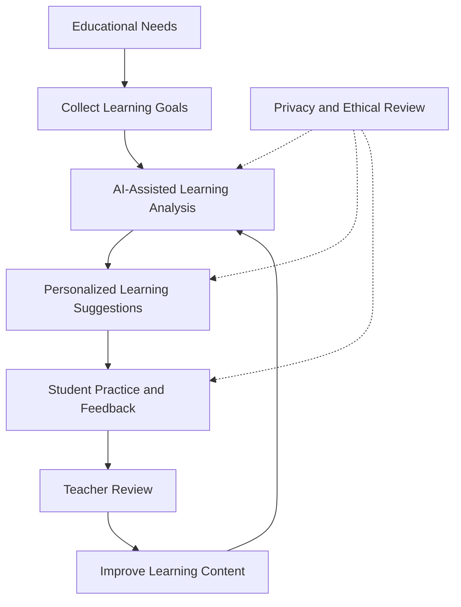

# AI in Education

A project exploring how artificial intelligence can be used in education and how AI may shape the future of learning.

## Project Purpose

The purpose of this project is to introduce the role of AI in education, discuss practical use cases, and consider both the opportunities and challenges that AI may bring to students, teachers, and educational institutions.

The project focuses on topics such as:

- Personalized learning
- AI-assisted teaching and learning
- Automated feedback and assessment
- Educational accessibility
- The future relationship between teachers and AI
- Responsible and ethical use of AI in education

## Technologies Used

This repository is currently a research and presentation project rather than a runnable software application.

- **Markdown** — project documentation
- **PDF** — presentation and project material
- **GitHub** — version control and project sharing

No API keys, passwords, or personal information are required or included.

## Main Features

- Explains the potential uses of AI in education
- Discusses the benefits of personalized and adaptive learning
- Presents possible future applications of AI-based educational tools
- Identifies challenges such as privacy, bias, accuracy, and over-reliance on AI
- Provides a foundation for future development of an educational AI application

## Installation and Usage

### Requirements

No programming environment is required to read the current project materials. You only need:

- A web browser or PDF reader
- Access to this GitHub repository

### View the Project

1. Clone the repository:

   ```bash
   git clone https://github.com/Athenahhw/AI-using-on-education.git
   cd AI-using-on-education
   ```

2. Open the project presentation PDF with a PDF reader.

3. Read the documentation and presentation materials to understand the project concept.

> There is currently no executable application, package manager setup, or development server in this repository.

## System Architecture / Project Flow

The current repository presents a conceptual project flow rather than an implemented software architecture:



### Flow Description

1. Identify the learning needs of students.
2. Define learning goals and suitable educational content.
3. Use AI to support analysis and generate learning suggestions.
4. Provide personalized practice or feedback.
5. Allow teachers to review and guide the learning process.
6. Improve future learning content based on feedback.
7. Apply privacy, safety, and ethical checks throughout the process.

## App Screen / Demo

This repository does not currently contain a working app or interactive demo. The available material is a project presentation in PDF format.

For a future application demo, this section could include:

- A student learning dashboard
- AI-generated study recommendations
- Question-and-answer or tutoring functionality
- Progress tracking
- Teacher review and feedback tools

## My Responsibilities

The project owner's main responsibilities included:

- Researching the relationship between AI and education
- Planning the project topic and presentation structure
- Organizing information about current and future educational applications of AI
- Discussing the benefits, risks, and ethical considerations of AI in learning
- Preparing the project presentation and documentation

## Known Limitations

- The repository currently contains research and presentation material rather than a complete application.
- There is no implemented AI model or backend service.
- There is no user interface, database, authentication system, or automated testing.
- The project does not currently measure learning outcomes with real user data.
- AI-generated recommendations may require teacher review to ensure accuracy and appropriateness.
- Privacy, fairness, accessibility, and security would require additional design and testing in a production system.

## Future Improvements

Possible future improvements include:

- Build a web or mobile learning application
- Add a secure backend and database
- Integrate an AI model through a protected server-side service
- Add personalized learning paths and progress tracking
- Provide teacher dashboards and review tools
- Add multilingual and accessibility support
- Evaluate the system with educators and students
- Add privacy protection, consent management, and data-retention policies
- Create automated tests and deployment workflows
- Add screenshots and a live demo after the application is implemented

## Security and Privacy

This repository is intended for educational and research purposes. Do not commit any of the following:

- API keys
- Passwords
- Access tokens
- Private credentials
- Student records
- Names, contact details, or other personal information

Use environment variables and secret-management tools for sensitive configuration in future software implementations.

## Project Status

**Status:** Research and presentation prototype

The project is a starting point for exploring future AI-based educational tools. A runnable application may be added in a later development stage.
